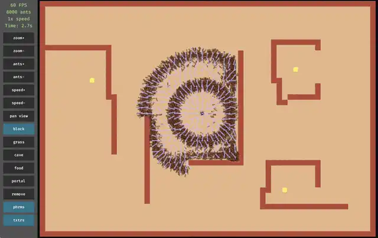
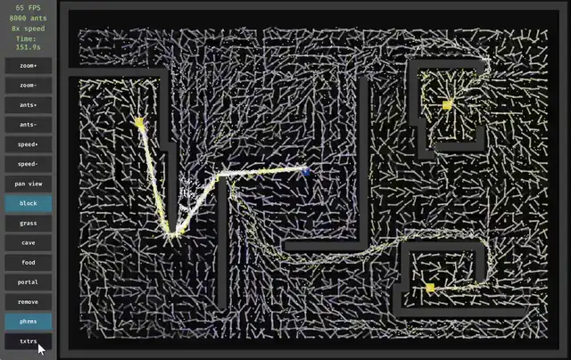
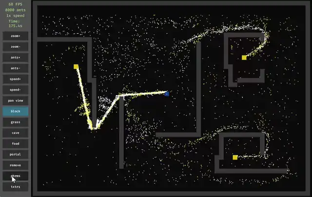

# Locas-Ants Bevy

[](https://github.com/olekkut/locas-ants-bevy/actions/workflows/ci.yml)
[](LICENSE)
[](https://www.rust-lang.org)
[](https://bevyengine.org)

A multi-threaded **ant colony swarm simulation** written in Rust with the [Bevy](https://bevyengine.org) game engine and its
Entity Component System. It is a port of [**piXelicidio/locas-ants**](https://github.com/piXelicidio/locas-ants)
(Lua + LÖVE) that keeps the original's behaviour but runs thousands of ants in parallel across every CPU core.

Ants leave time-stamped pheromone trails on a shared grid, find food, carry it back to the cave, and converge on
short, well-used routes, with no central planner. You can draw walls, food, grass and portals while the
simulation runs and watch the colony adapt.

## Demo

8,000 ants on a walled map. The colony spreads out from the cave (the blue square in flat mode), finds the
three food sources and settles on trails that route around the walls.

<p align="center">
  
  <br><sub><b>Textured sprites + pheromone overlay</b> (2× playback speed)</sub>
</p>

<table>
  <tr>
    <td align="center" width="50%">
      
      <br><sub><b>Flat colors + pheromones</b>: gold lines point towards food, blue lines towards the cave</sub>
    </td>
    <td align="center" width="50%">
      
      <br><sub><b>Flat colors, overlay off</b>: white ants are searching, yellow ants are carrying food</sub>
    </td>
  </tr>
</table>

## Features

- **Parallel ECS simulation.** Each ant is an entity with plain-data components. One consolidated system updates
  them with `par_iter_mut`, keeping sensing, pheromones, physics and cell interaction in a single cache-friendly pass.
- **Lock-free shared memory.** Each grid cell packs its pheromone (frame timestamp + direction hint) into an
  `AtomicU64` and updates it with compare-and-swap, so threads never block each other.
- **Ring-buffer trail memory.** Every ant remembers its last 10 positions and writes the oldest one into the
  grid, which smooths trails into straight lines instead of jittery local loops.
- **Obstacle avoidance.** A forward sensor plus ±30° side sensors steer ants around walls, and a sliding
  collision response keeps them moving along walls instead of getting stuck.
- **Live map editor.** Paint walls, slow-down grass, caves, food and linked teleport portals with the mouse.
  You can also save and load ASCII maps.
- **Single draw call for all ants.** All ants are batched into one dynamic mesh, either as flat arrowheads or
  textured animated sprites carrying food.
- **Runtime controls.** Spawn or remove ants, change the simulation speed (pause to 8×), zoom and pan, and toggle
  the pheromone overlay and textures.

## Download

Grab the latest build from the [**Releases page**](https://github.com/olekkut/locas-ants-bevy/releases/latest).
Each download is a single file with all sprites and built-in maps compiled in, so there is nothing to install.

| OS                                | File                     | How to run |
| :-------------------------------- | :----------------------- | :--------- |
| Windows 10/11 (x64)               | `*-windows-x86_64.exe`   | Double-click it. If SmartScreen warns, choose *More info → Run anyway*. |
| macOS 11+ (Apple Silicon & Intel) | `*-macos-universal.zip`  | Unzip and open *Locas-Ants Bevy.app*. The first time, right-click → *Open*, because the app is not notarized. |
| Linux (x64, glibc 2.35+)          | `*-linux-x86_64.tar.gz`  | `tar -xzf` the archive, then run `./locas-ants-bevy`. |

The binaries are not code-signed, which is why Windows and macOS ask for confirmation on first launch.

## Building from source

Install the Rust toolchain from [rustup.rs](https://rustup.rs), then:

```bash
git clone https://github.com/olekkut/locas-ants-bevy.git
cd locas-ants-bevy
cargo run --release
```

The binary embeds `assets/` and the built-in maps, so `target/release/locas-ants-bevy(.exe)` can be copied
anywhere and run on its own.

### Windows

Double-click `build_and_run.bat`. The app uses DirectX 12 by default, the most reliable backend on Windows.
Set `WGPU_BACKEND` (for example `vulkan`) to override it.

### macOS

Works out of the box on Metal: `./build_and_run.sh` or `cargo run --release`.

### Linux

Building needs a few system packages:

| Distribution    | Command |
| :-------------- | :------ |
| Ubuntu / Debian | `sudo apt-get install pkg-config libx11-dev libasound2-dev libudev-dev libwayland-dev libxkbcommon-dev` |
| Fedora / RHEL   | `sudo dnf install pkgconf-pkg-config libX11-devel alsa-lib-devel systemd-devel wayland-devel libxkbcommon-devel` |
| Arch Linux      | `sudo pacman -S --needed pkgconf libx11 alsa-lib systemd-libs wayland libxkbcommon` |

Then run `./build_and_run.sh`.

## Controls

### Sidebar

| Button              | Action |
| :------------------ | :----- |
| `zoom+` / `zoom-`   | Zoom the camera (the mouse wheel zooms towards the cursor) |
| `ants+` / `ants-`   | Spawn or remove 1,000 ants at the cave |
| `speed+` / `speed-` | Simulation steps per frame: paused, 1×, 2×, 4×, 8× |
| `phrms`             | Toggle the pheromone overlay (gold = towards food, blue = towards cave) |
| `txtrs`             | Toggle textured sprites and flat-color rendering |

### Editor tools

Pick a tool in the sidebar, then left-click or drag on the map.

| Tool       | Effect |
| :--------- | :----- |
| `pan view` | Drag to move the camera (right or middle mouse drag pans with any tool) |
| `block`    | Impassable wall |
| `grass`    | Passable terrain that slows ants down |
| `cave`     | Nest: ants drop food here |
| `food`     | Infinite food source |
| `portal`   | First click places a blue portal, the second click places its linked orange twin |
| `remove`   | Clear a cell back to empty ground |

### Keyboard

| Key           | Action |
| :------------ | :----- |
| `Space`       | Toggle the pheromone overlay |
| `1` / `L`     | Load `maps/default.txt` |
| `2`, `3`, `4` | Load `maps/maze.txt`, `maps/bottleneck.txt`, `maps/split.txt` |
| `5`           | Load `maps/saved_map.txt` |
| `S`           | Save the current map to `maps/saved_map.txt` |

## Maps

Maps are plain-text 61×43 grids, read top row first. The four maps in [`maps/`](maps) are compiled into the
binary. A file with the same name in a `maps/` folder next to where you run the app overrides the built-in copy,
so you can edit maps without rebuilding. `S` writes `maps/saved_map.txt` and creates the folder if needed.

| Char | Cell          |
| :--: | :------------ |
| `#`  | Wall          |
| `.`  | Empty         |
| `C`  | Cave (nest)   |
| `F`  | Food          |
| `g`  | Grass         |
| `P`  | Blue portal   |
| `p`  | Orange portal |

A malformed map is rejected as a whole, and the current map stays loaded.

## How it works

```
             ┌─────────────── ant_update_system (par_iter_mut, N steps/frame) ────────────────┐
  Entities   │  1. read/write pheromones   2. FOV obstacle   3. physics +     4. food / cave / │
  (ants) ──▶ │     in the 3×3 neighbourhood   avoidance         wall sliding     portal cells   │
             └───────────────────────────────────────┬────────────────────────────────────────┘
                                                     │ lock-free CAS
                                          SwarmGrid (AtomicU64 per cell)
                                                     │
                     mesh_render_update_system ──▶ one dynamic mesh ──▶ GPU (wgpu)
```

Each pheromone stores **when** (the frame number) an ant last saw food or the cave, and **where** it came from
(the oldest position in its ring buffer). An ant that is searching follows the freshest timestamp it can find
that is newer than anything it has already seen, which makes the colony converge on the most recently
reinforced route.

| Path                                     | Contents |
| :--------------------------------------- | :------- |
| [`src/main.rs`](src/main.rs)             | App setup, resources, scene and ant spawning |
| [`src/components.rs`](src/components.rs) | ECS components and the ant bundle |
| [`src/systems.rs`](src/systems.rs)       | Simulation, rendering, debug overlay and map loading systems |
| [`src/grid.rs`](src/grid.rs)             | `SwarmGrid`, atomic pheromone packing, map I/O and unit tests |
| [`src/interaction.rs`](src/interaction.rs) | Camera controls and the map editor |
| [`src/ui.rs`](src/ui.rs)                 | Sidebar UI |

More detailed design notes (in Polish) are in [`AGENTS.md`](AGENTS.md), which covers the agent components and systems, and
[`AGENT-MEMORY.md`](AGENT-MEMORY.md), which covers individual and swarm memory and the lock-free grid.

## Development

```bash
cargo fmt --all          # format
cargo clippy --all-targets -- -D warnings
cargo test               # grid / pheromone / map I/O unit tests
```

Debug builds compile dependencies with `opt-level = 3`, so `cargo run` stays fast enough to use. CI runs
formatting, Clippy and tests on Linux, Windows and macOS. Pushing a `v*` tag builds the single-file binaries
and publishes them as a GitHub release ([`release.yml`](.github/workflows/release.yml)).

## Credits

- Original simulation, behaviour design and sprite art:
  [**locas-ants**](https://github.com/piXelicidio/locas-ants) by [piXelicidio](https://github.com/piXelicidio), MIT
  licensed.
- Rust / Bevy ECS port: [Aleksander Kutycki](https://github.com/olekkut).

## License

[MIT](LICENSE). The license covers both the original work and this port.
